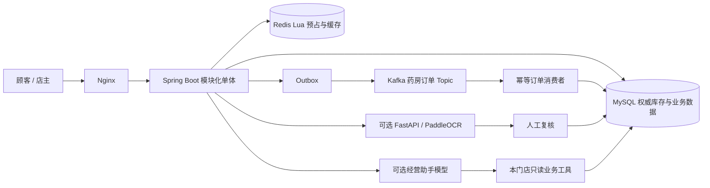

# 系统架构

## 运行组件

```text
顾客浏览器 / 店主工作台 -> Nginx -> Spring Boot 模块化单体 API
                                      |-> MySQL 8（权威库存、批次、订单、Outbox、审核记录）
                                      |-> Redis 7（Lua 预约预占、限流、缓存与失效广播）
                                      |-> Kafka（药房订单异步链路、原有聊天消息）
                                      |-> FastAPI + PaddleOCR（可选图片识别；只产出待审核候选）
                                      `-> OpenAI 兼容模型（可选经营助手；只读工具）

药房预约链路：API -> Redis Lua 原子预占 -> MySQL 请求记录与 Outbox -> Kafka -> 幂等消费者 -> MySQL FEFO 库存事务。
药房目录使用 Caffeine + Redis；版本化失效通过 Redis Pub/Sub 广播，TTL 负责最终兜底。


```

药房模块与原点评/聊天模块共用 Spring Boot、MySQL、Redis、Kafka 和 Nginx。药房表由 `db/migration` 下的 Flyway V1–V9 增量迁移创建；原有表由原项目初始化脚本管理。线上测试运行在独立 Compose project、网络、数据卷和 Nginx 回环端口中。

## 核心数据流

药品和活动目录由 API 读 MySQL 并经 Caffeine + Redis 返回。活动发布先校验门店、药品和批次，再初始化 Redis 活动库存。预约入口在 Redis Lua 中校验活动状态、时间、限流、幂等与可预约量；成功请求先写 MySQL 请求记录和 Outbox，再由单一 Kafka 消息链路异步创建订单。消费者在 MySQL 事务内选择 FEFO 批次、更新库存并记录流水。MySQL 是最终库存账本，Redis 用于快速准入，不替代数据库核算。

入库 OCR 仅生成待复核候选，不直接改变库存。店主逐行选定商品并确认后，服务在同一数据库事务内调用全部批次入库逻辑、写入审核记录并完成单据状态转换；任何一行失败都会回滚整次确认。

## 边界与限制

- Kafka、Redis 与 MySQL 之间没有分布式事务；通过 Outbox、幂等键、重试和死信表处理可恢复失败。不能据单机联调推断故障场景均已验证。
- 在线预约仅适用于 OTC 商品。处方药不进入活动预约。
- 登录依赖原项目认证。药店管理操作同时校验店主归属。
- 经营助手工具从当前登录负责人解析门店，只读库存和出库流水；规则补货量需要店主审核。
- OCR 图片服务可选，识别候选必须经店主人工复核后才能写入库存。
- 服务器未部署真实 OCR 模型，也未配置真实 AI 密钥；OCR 联调使用明确标记的 mock，上游不可用时上传返回服务不可用且不改库存。
- 当前 2 GiB 主机资源预算限制了模型服务部署；见 `SERVER_TEST.md`。
