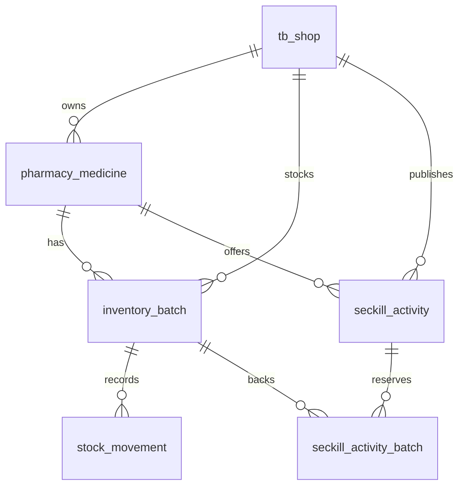

# 数据库改造进度

现有用户和店铺继续使用 `tb_user`、`tb_shop`；`tb_shop_owner` 关联门店与负责人。`V1__pharmacy_inventory.sql` 只新增 `pharmacy_medicine`、`inventory_batch` 和 `stock_movement`，不删除或修改原表。

`inventory_batch` 对 `(store_id, medicine_id, batch_no)` 建唯一约束，检查日期及各库存非负，并约束 `on_hand_qty = available_qty + activity_reserved_qty + order_reserved_qty + quarantined_qty`。当前已实现入库、活动预留、订单预留、释放、核销及库存流水；采购单与正式入库审核流程仍未完成。当前 `sale_category` 只是商品分类，不代表已经验证销售合规，更不允许据此放行处方药预约。

V2 新增 `seckill_activity` 和 `seckill_activity_batch`。发布活动时在一个 MySQL 事务内锁定 FEFO 批次，把足额库存从 `available_qty` 转入 `activity_reserved_qty`，记录 `ACTIVITY_RESERVE` 流水；库存不足时整个事务回滚。Redis 初始化失败时活动保留 `PUBLISHING`，可安全重试；已发布活动的 Redis 数据丢失或部分存在时初始化脚本拒绝重置库存，避免超卖。V3–V5 新增请求、订单、Outbox、DLT 及状态约束。预约和订单链路已在隔离服务器跑通；超时补偿和活动结束释放已实现但尚未做故障注入。

Flyway 默认关闭，以避免已有库在部署时自动迁移。启用前须备份并核对目标库、迁移历史及表名冲突，只有对正确数据库显式设置 `PHARMACY_FLYWAY_ENABLED=true` 才会执行；已有非空库从 baseline 0 开始管理新增迁移。服务器隔离测试库已验证首次接管与 V1 迁移，尚未验证迁移失败恢复。当前 Flyway 对 MySQL 8.4 输出版本支持警告，需在生产部署前解决版本兼容性并重新测试。

V6 新增 `inbound_document` 与 `inbound_document_review`。负责人上传图片后，Java 将 OCR 原文和候选 JSON 存为 `PENDING_REVIEW`；用户确认时在同一事务内调用 `MedicineService.receiveBatch`，写入 `inventory_batch`、`stock_movement`、复核记录并把单据改为 `CONFIRMED`。V8 将单据审核改为多行明细；V9 在审核明细保存采购单价。确认时规格必须匹配当前门店所选 SKU 档案。单据图像本身不落库；OCR 文本与复核修正作为审计内容保留。真实 PaddleOCR 推理和供应商单据准确率评测尚未完成。
