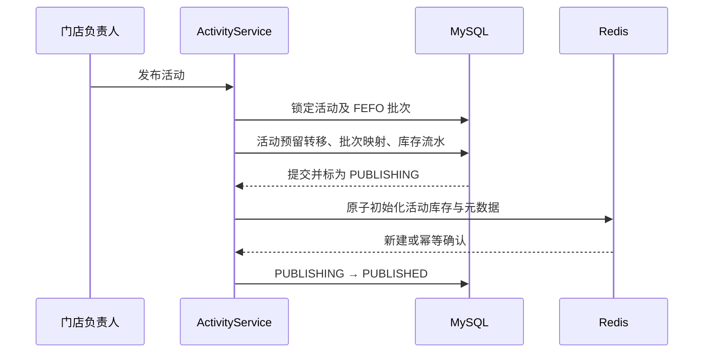

# 药房限量预约设计与进度

## 已实现：活动创建与库存预留

门店负责人创建活动时，服务端从登录上下文校验门店归属。仅允许已启用的 OTC 商品和医疗用品建立活动；处方药不能走线上预约入口。活动发布时间和有效时段由后端校验。

发布活动时，MySQL 事务锁定活动行以及该门店、商品的可售批次，按有效期、批次 ID 升序规划 FEFO。足额后逐批把 `available_qty` 转入 `activity_reserved_qty`，创建 `seckill_activity_batch` 并写 `ACTIVITY_RESERVE` 流水；任何批次更新失败或库存不足都会回滚整个事务。活动先进入 `PUBLISHING`，Redis 初始化完成后才变成 `PUBLISHED`。

Redis 初始化脚本一次写入库存、状态和活动元数据。脚本支持重试而不覆盖已扣减库存；部分 key、未知状态、以及 MySQL 显示已发布但 Redis key 丢失时均失败关闭。Redis 与数据库状态不一致时，不通过 `SET` 或 `INCR` 猜测并覆盖库存。

## 待实现

下一步增加持久化预约请求，然后用独立 Lua 原子完成活动时段、活动限流、IP/用户限流、用户限购、requestId 幂等、库存扣减和超时 ZSet。Redis 只用于准入和预占；MySQL 仍是最终账本。之后加入 Outbox Relay、Kafka 幂等消费者、订单批次预留、取消释放、核销及超时补偿，并通过故障注入验证 Redis 成功后数据库失败、重复消息、消费者宕机和 Offset 重试。

订单、取消、核销、活动结束释放、requestId 持久化、Outbox、Kafka 和并发预约目前都未实现。当前发布入口还没有在正式工作台加入表单，也尚未部署这批代码。
